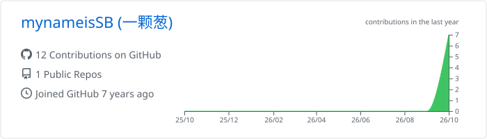
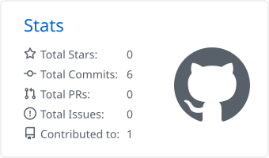
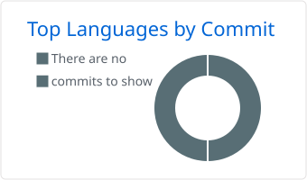

  
  

---

### 📝 最新文章

| 文章 | 标签 |
| --- | --- |
| [REA：让 AI Agent 帮你逆向分析任何软件](https://lstrive.online/#/post/rea-reverse-engineer-anything) | `AI` `开源项目` `MCP` |
| [30 行 Python：批量重命名文件的小脚本](https://lstrive.online/#/post/python-batch-rename) | `脚本` `Python` |

<a href="https://lstrive.online">查看全部文章 →</a>

### 📊 GitHub 数据

<!-- 下面的统计图由 .github/workflows 里的 Actions 每天自动生成，首次需要手动运行一次 -->

  

  
  

  

  <picture>
    <source media="(prefers-color-scheme: dark)" srcset="https://raw.githubusercontent.com/mynameisSB/mynameisSB/output/github-snake-dark.svg" />
    
  </picture>

